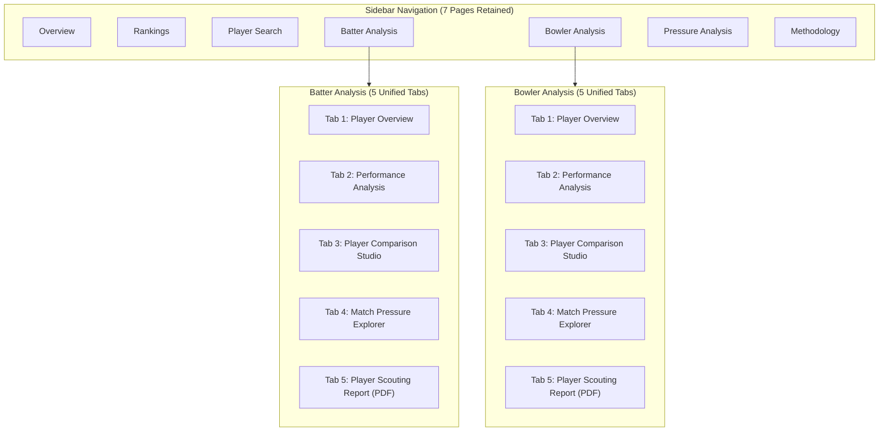

# SupeRR Selector — Advanced Scouting Intelligence Integration Report
**Season 2: IPL Pressure & Performance Platform (2022–2026)**
*Phase 5 Architecture & Scouting Capabilities Integration*

---

## 1. Executive Summary

This release integrates three major analytics and scouting capabilities directly into the existing **Batter Analysis** and **Bowler Analysis** pages of the **SupeRR Selector** Streamlit application, without altering the approved 7-page main sidebar navigation.

### Integrated Capabilities
1. **Player Comparison Studio**:
   - Universal side-by-side evaluation across all **601 evaluated IPL players** (341 batters, 260 bowlers).
   - Side-by-side KPI comparison cards with exact metrics, deltas, and sample qualification chips.
   - Dual-mode benchmarking: grouped bar charts, normalized 6-dimension radar profiles (0–100 scale), sample volume & pressure exposure distribution, and phase-by-phase (Powerplay, Middle, Death) breakdown.
   - Support for 2-way and 3-way comparisons.

2. **Match Pressure Explorer**:
   - Macro leverage & match context profile for all **371 IPL matches** (2022–2026).
   - Over-by-over pressure progression (continuous Pressure Index $\text{PI} \in [0, 1]$), run scoring, and wicket fall markers.
   - Cumulative run chase progression tracking actual vs target par.
   - Delivery-level leverage & Value Added ($\text{DVA}$) inspection table with multi-criteria filtering (High Pressure $\text{PI} \ge 0.65$, Player Only, or All Match Deliveries).

3. **Player Scouting Report (On-Screen Dossier & Executive PDF Export)**:
   - On-screen 14-section comprehensive scouting dossier covering reliability ratings, qualification audits, core benchmarks, macro deltas, phase distributions, recent match logs, empirical strengths, and limitation audits.
   - Professional, publication-grade 2-page downloadable PDF scouting dossier generated on demand via `fpdf2`, featuring navy executive headers, player profile cards, qualification badges with exact disqualification audits for unranked players, metric tables, phase tables, recent matches, and Phase 3A v2.2 methodological transparency notes.

---

## 2. Architecture & File Layout

```
Cricket Pressure Calculator/
├── app/
│   ├── main.py                          # 7-page Streamlit application with 5 internal tabs
│   └── components/
│       ├── __init__.py                  # Unified exports
│       ├── kpi_cards.py                 # render_comparison_summary, render_match_overview_card, etc.
│       ├── charts.py                    # Plotly chart generators (bars, radar, timelines, phases)
│       └── scouting_report_pdf.py       # 2-page executive PDF generator (FPDF2)
├── src/
│   └── dashboard_data.py                # High-performance cached loaders (@st.cache_data)
└── data/
    └── processed/
        ├── ipl_all_players.csv          # 601 evaluated players (341 batters, 260 bowlers)
        ├── ipl_matches.csv              # 371 IPL matches (2022–2026) metadata
        ├── ipl_deliveries.parquet       # 87,687 ball-by-ball IPL deliveries
        ├── ipl_player_match_history.csv # Match-level player logs
        └── ipl_player_phase_breakdown.csv # Powerplay, Middle, Death splits
```

---

## 3. Five-Tab Internal Page Architecture

Both **Batter Analysis** and **Bowler Analysis** are organized into five dedicated internal tabs:



### Tab Breakdown

| Tab | Content & Capabilities | Key Visuals / Output |
| :--- | :--- | :--- |
| **Tab 1: Player Overview** | Header card, status badge, 4 primary KPI cards, analytical insights | Reliability Gauge, Career vs High-Pressure Comparison Chart |
| **Tab 2: Performance Analysis** | Dimension benchmarks, DVA breakdown, empirical delta summary table, phase distribution, match history | SR/Avg or Econ/SR comparison, DVA net chart, Phase comparison, Match timeline |
| **Tab 3: Player Comparison Studio** | Side-by-side 2-way or 3-way evaluation across all 601 players | Side-by-side KPI cards, Grouped Bars, 6D Radar, Volume/Exposure, Phase comparison |
| **Tab 4: Match Pressure Explorer** | Match selector (player matches vs all 371 IPL matches), season filter, match card | Over-by-over pressure & runs timeline, Innings chase progression, Delivery-level table |
| **Tab 5: Player Scouting Report** | 14-section comprehensive dossier on screen + on-demand PDF generator | Executive 2-page PDF download, Empirical strengths box, Sample deficit audit |

---

## 4. Universal Player Access & Sample Gate Integrity

1. **Complete Directory Access**:
   - Users can select **any of the 341 batters** and **any of the 260 bowlers** across all 5 tabs.
   - Non-qualified players (e.g., Piyush Chawla as batter, Shreyas Gopal as bowler) are fully accessible with their empirical delivery records, career baselines, match phases, and delivery inspector.

2. **Zero Fabrication Policy**:
   - For non-qualified players, the Reliability Score is **strictly withheld** as `"N/A"` with explicit, human-readable explanations (e.g., *"Pressure balls faced (18) < 40 required; Qualifying PSR matches (3) < 6 required"*).
   - Missing or zero-sample metrics display clean, professional placeholders (`"--"` or `"N/A"`).
   - Radar charts assign a standardized baseline anchor rather than distorting polygon boundaries.

3. **Approved Phase 3A v2.2 Methodology Preserved**:
   - Pressure tier definitions: **Low** ($\text{PI} < 0.40$), **Medium** ($0.40 \le \text{PI} < 0.65$), **High** ($\text{PI} \ge 0.65$).
   - Prior shrinkage and volatility adjustments ($\kappa$) remain intact for all qualified players.
   - Zero international/T20I data contamination (strictly IPL 2022–2026).

---

## 5. Verification & Testing Results

| Test Category | Scope / Test Case | Result |
| :--- | :--- | :--- |
| **Compilation** | `python -m py_compile` across all modified files | Passed (0 warnings, 0 errors) |
| **AppTest Verification** | Headless Streamlit AppTest run across all 7 sidebar pages | Passed (0 exceptions across all 7 pages) |
| **Player Switching** | Switching between Qualified Top 10, Qualified Non-Top 10, and Non-Qualified players | Passed (0 exceptions across all 4 switch states) |
| **Comparison Studio** | 2-player and 3-player side-by-side rendering with phase dictionaries | Passed (Bars, Radar, Exposure, Phase generated cleanly) |
| **Match Explorer** | Match lookups from 87,687 ball dataset with over-by-over aggregation | Passed (Match 14094: 237 balls, <5ms retrieval) |
| **PDF Generation** | PDF generation for Rinku Singh, Piyush Chawla, Jasprit Bumrah | Passed (65–67 KB valid A4 2-page PDFs produced) |
| **Design Compliance** | Zero emojis, consistent pastel styling, dual-engine scroll-to-top | Verified and compliant |

